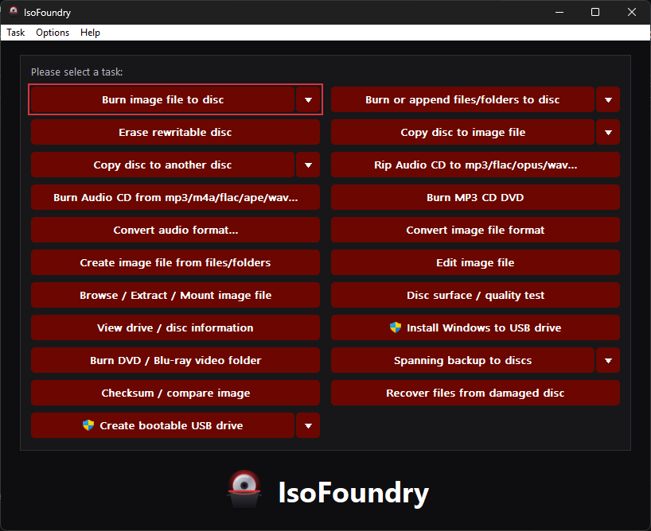
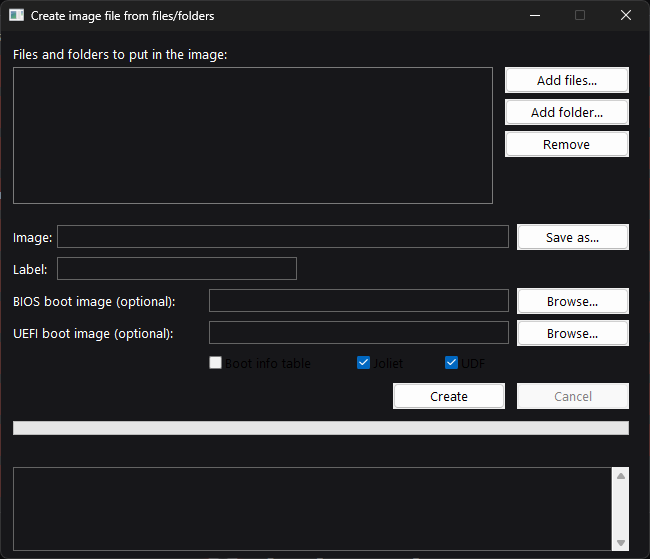
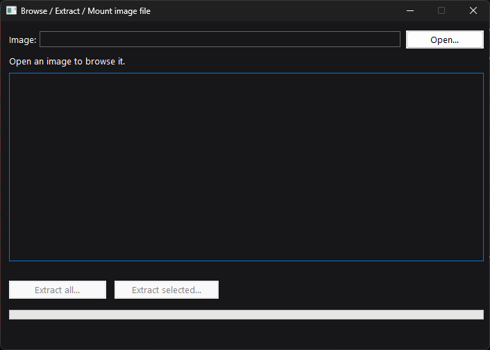
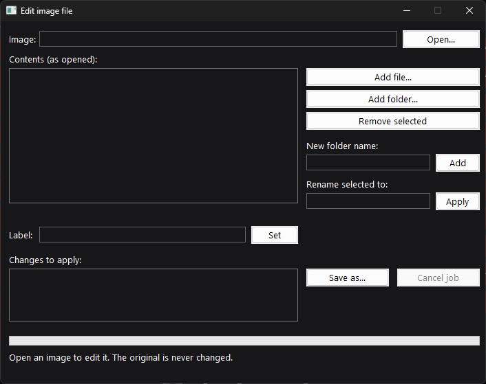
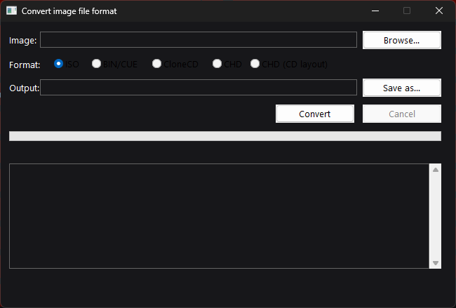
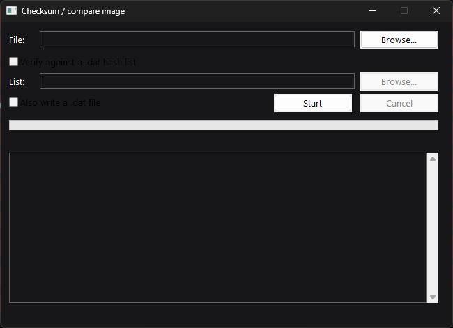

<p align="center"></p>

# IsoFoundry

**Open source disc burning, imaging & bootable USB suite** for Windows 10 22H2 / 11 (x64): one dark window with a grid of tasks, in the spirit of AnyBurn Pro — plus a full command line for every task. Free, offline, no telemetry.

## TL;DR

IsoFoundry is a single free Windows program for working with CDs, DVDs, Blu-rays, disc image files (like `.iso`) and bootable USB drives. You pick a job from a grid of big buttons — burn a disc, copy one, turn files into an image, check an image for errors — or run the same job from the command line. The current release (0.2.0) is the complete disc-image toolkit: create, browse, extract, edit and convert images, mount them, and check them against known-good hash lists. Disc burning, audio and USB writing follow on the [roadmap](#roadmap). Nothing in IsoFoundry needs the internet, and it never sends data anywhere.

## Status

- **0.2.0 (released)** — the complete M1 image toolkit (create, browse, extract, edit, convert, mount, checksum, verify): the task grid opens working windows for the five image tasks, and the same jobs run from the command line. The task windows open and render correctly on a real desktop (checked from the owner's captures, 2026-11-07); a full job run in each window is still to be confirmed.
- **0.3.0 (in development)** — M2 USB: Create bootable USB and Install Windows to USB, in the task windows and from the command line (`usb`, `windows-to-usb`). Tested end-to-end against disk-image files; writing to a physical disk and booting from the result are still to be confirmed on real hardware.
- **0.1.0** — the M0 shell: main window, command line and elevated helper.
- **Planned** — audio conversion (0.4.0), disc burning (0.5.0), disc copying and ripping (0.6.0), integration extras (0.7.0). See the [roadmap](#roadmap).

## What the program does today

- **Main window** — a 21-task grid (owner-drawn buttons with split-button menus; tasks that need administrator rights carry a shield mark), menus for Task / Options / Help, tooltips on every control, full keyboard navigation, a visible focus ring, a high-contrast palette, Per-Monitor DPI v2 scaling, a dark title bar, and window placement that is saved and checked against your monitors. One instance at a time.
- **Command line** — also as the console twin `isofoundry.com`, so shells wait for it and capture its output: `--version`, `list` (every task, its CLI name, and when it ships), `helper-check [--elevated]`, `report --out FILE` (a redacted drive report for bug reports), and `clean`. Global `--json`, `--dry-run` and `--verbose/--debug` options. The image commands below all work; tasks from later milestones answer "not implemented yet" (exit code 40) until their milestone ships.
- **Elevated helper** — `isofoundry-helper.exe` does the few jobs that truly need administrator rights. It talks to the main program over a named pipe restricted to you, Administrators and SYSTEM, checks the calling process, and uses a per-session nonce with typed messages only.
- **Settings & data** — versioned TOML settings with atomic writes (an unreadable settings file is quarantined, never silently overwritten), local logs, and a portable mode: put an `IsoFoundry.portable` file next to the program and everything stays in `data\` beside it.
- **Drive reports** — Help → Export drive report writes a redacted JSON report you can attach to a "Drive report" issue, which is how real-drive compatibility gets confirmed (see [Hardware compatibility](#hardware-compatibility)).

## Image tools

These jobs run from the task windows and the command line:

- **`create-image`** — build an ISO from files and folders: ISO 9660 + Joliet + UDF 1.02 in one image sharing a single copy of the data, files over 4 GB, El Torito boot entries for BIOS (optional boot information table) and UEFI. Written to a `.part` file and renamed only when complete, so a cancelled build never leaves a half-written image.
- **`image-info`** — an image's container format, tracks, file systems, label and boot entries.
- **`extract`** — copy files out of an image (everything, or one file/folder), renaming names Windows cannot store, and keeping nothing half-written on cancel.
- **`edit-image`** — add, remove, rename, create folders, change the label, saved as a new image; untouched files are copied straight from the source, and BIOS/UEFI boot entries are kept.
- **`convert-image`** — any readable image to ISO, BIN/CUE, CloneCD (CCD/IMG/SUB) or CHD.
- **`checksum`** — CRC32, MD5, SHA-1 and SHA-256 in one pass; `--dat` also writes a Logiqx-style `.dat` hash file.
- **`verify --dat`** — look a file's hashes up in a known-good `.dat` list (for example a redump list) and report match or no match.
- **`compare`** — byte-for-byte comparison of two files.
- **`mount` / `unmount`** — mount an image read-only with Windows' built-in virtual disk support; other formats are converted to a temporary ISO first, which is removed on unmount.

Formats: ISO 9660 (with Rock Ridge names), Joliet, UDF 1.02–2.60 (physical, sparable and metadata partitions), multi-extent files, El Torito boot catalogs (BIOS and UEFI). CD images: BIN/CUE (single and multi-file; MODE1, MODE2 and audio tracks), CloneCD CCD/IMG/SUB, sheetless raw `.bin`/`.img`, and MAME CHD v5 — reading `zlib`/`cdzl` discs and writing CD (`cdzl`) and DVD (`zlib`) CHDs whose SHA-1s match chdman 0.264 byte for byte on the test images. Nero NRG and Alcohol MDS/MDF are read-only and marked unverified. Raw sector ECC/EDC generation and checks, and Q-subchannel generation, are included. Known format limits are listed in [docs/LIMITATIONS.md](docs/LIMITATIONS.md).

## USB tools (in development, 0.3.0)

- **`bootable-usb`** — turn an ISO into a bootable USB drive: partition it (MBR or GPT), format FAT32 and copy the image's files, or copy the image byte-for-byte in raw mode with an optional SHA-256 verify afterwards. `usb read` copies a drive back to an image file.
- **`install-windows-usb`** — the same write with Windows installer layouts: MBR+FAT32 (default), GPT+FAT32, or GPT+NTFS for install images over the FAT32 file limit. The boot files are Microsoft's own, copied unchanged from the ISO, so Secure Boot keeps working.

Writing is guarded: the system disk, the boot/pagefile disk and fixed disks are refused, and a target with mounted volumes or over 64 GB needs a typed ERASE confirmation. The engine is tested against disk-image files (the VHDX route); physical disks are **Unverified** until exercised on real hardware.

## Command line

Run commands as `isofoundry …` or `isofoundry.com …` (calling `isofoundry.exe` directly works, but the shell won't wait for it). No command opens the window.

```text
isofoundry list                                   Every task, its CLI name, and when it ships
isofoundry report --out report.json               Redacted drive report for a GitHub issue
isofoundry create-image C:\Files --out disc.iso --label MYDISC --boot-efi C:\boot\bootx64.efi
isofoundry image-info disc.iso
isofoundry extract disc.iso --out C:\Out --path Docs/manual.pdf
isofoundry edit-image disc.iso --out disc2.iso --add Extras=C:\Extras --remove Docs/old.txt
isofoundry convert-image game.cue --out game.chd
isofoundry checksum disc.iso --dat disc.dat
isofoundry verify disc.iso --dat redump.dat
isofoundry mount disc.iso
isofoundry unmount disc.iso
isofoundry usb list                                Every disk, and whether it is safe to write
isofoundry usb write linux.iso --disk 2 --yes      Bootable USB: copy the image's files (MBR; add --scheme gpt)
isofoundry usb write linux.iso --disk 2 --mode raw --verify --yes
isofoundry usb read --disk 2 --out stick.img       Copy a USB drive back to an image file
isofoundry windows-to-usb win11.iso --disk 2 --yes  Windows installer USB (add --layout gpt-ntfs for a big install.wim)
isofoundry clean --dry-run                        Show what would be removed; change nothing
```

Global options: `--json` (machine-readable output), `--verbose` / `--debug`, `--dry-run`, `--yes`. Exit codes are documented in `isofoundry --help` (0 ok, 1 error, 2 usage, 3 cancelled, 10 no drive/media, 13 verify mismatch, 20 elevation denied, 40 not implemented yet, and more).

## Screenshots

All captures are from real runs on a real Windows desktop. No placeholder images are used.

The 0.2.0 main window — the 21-task grid:



**Create image** — files/folders, label, optional boot images:



**Browse / extract image** — contents and extraction:



**Edit image** — stage changes, save as a new image:



**Convert image** — ISO, BIN/CUE, CloneCD or CHD:



**Checksum** — hashes, `.dat` writing and verification:



## Requirements

- Windows 10 22H2 or Windows 11, x64. Releases ship x64 only.
- No runtime prerequisites — the release builds are self-contained native executables.
- Administrator rights are asked for only by the tasks that need them, with the reason shown first.
- Disc features need an optical drive, obviously — but see [Hardware compatibility](#hardware-compatibility): they are developed against a simulated drive.

## Install

Download from [Releases](https://github.com/SeanShaffer88/IsoFoundry/releases) — every release carries just one installer and one portable zip:

- `IsoFoundry-v<version>-x64-Setup.exe` — installs for you only (no administrator rights) or for all users
- `IsoFoundry-v<version>-x64-Portable.zip` — unzip and run; settings stay in `data\` beside the program

Check downloads against `SHA256SUMS.txt`. Builds are not code-signed yet, so Windows SmartScreen may warn on first run.

## Configuration

Settings live in a versioned TOML file in the program's data folder (portable builds: `data\` beside the program; installed builds: your per-user data folder). Options today cover log detail, the finish sound and the window placement; the data folder can be opened from Options → Open data folder. `isofoundry clean` removes settings, logs and reports (`--dry-run` lists them first, `--yes` skips the confirmation). There is no account, no sync and nothing to sign into.

## Build from source

You need the Rust toolchain (Rust 1.82 or newer; the workspace is edition 2021).

```powershell
# Official builds: GitHub Actions, MSVC x64 (static CRT)
# Local build without Visual Studio:
rustup target add x86_64-pc-windows-gnu
cargo build --release --target x86_64-pc-windows-gnu
```

Local GNU-toolchain builds are a convenience path; the published releases are the MSVC builds from CI.

## Project structure

| Crate | What it holds |
|---|---|
| `crates/isofoundry` | The app: Win32 window, task grid, CLI (`isofoundry`, plus `isofoundry-cli` and `isofoundry-portable` entry points) |
| `crates/isofoundry-helper` | The elevated helper process and its named-pipe server |
| `crates/if-image` | Disc images: ISO 9660/Joliet/UDF read & write, BIN/CUE, CCD, NRG, MDS, CHD, conversion, editing, El Torito |
| `crates/if-hash` | CRC32/MD5/SHA-1/SHA-256 in one pass; Logiqx/redump `.dat` read & write |
| `crates/if-core` | Shared core: settings, paths, logging, jobs, IPC, drive reports, UI strings |

## Tests

```powershell
cargo test --workspace
```

The image test suite runs against real fixture images in `crates/if-image/tests/fixtures/` (plain, Joliet/Rock Ridge, bootable and UDF ISOs, CD and DVD CHDs) and covers reading, writing, conversion and editing end to end — including the byte-for-byte SHA-1 match against chdman for written CHDs. Disc burning is tested against a simulated drive; see [docs/TESTING.md](docs/TESTING.md).

## Hardware compatibility

Disc features are developed against a simulated drive — the developer has no optical drive. Real-drive results come from users: Help → **Export drive report**, then open a "Drive report" issue with it attached. Confirmed drives and results are tracked in [docs/COMPATIBILITY.md](docs/COMPATIBILITY.md). USB features are tested against attached VHDX disks and QEMU boot only; real flash hardware is **Unverified**.

## Privacy & security

- Works fully offline; no telemetry, no ads, no accounts. Network features (metadata lookup, AccurateRip, update check) are off until you enable them, and none exist yet in 0.1.0.
- Administrator rights are used only through the helper, whose pipe accepts connections only from your user account, Administrators or SYSTEM, verifies the calling process, and speaks typed messages with a per-session nonce.
- IsoFoundry does **not** remove or bypass copy protection (CSS, AACS, BD+, game-disc protections), and does not author or transcode video — it only burns existing VIDEO_TS / BDMV folders. Protected discs will fail or copy without working protection.

## Limitations

The honest list lives in [docs/LIMITATIONS.md](docs/LIMITATIONS.md) and is kept current every release. Headlines: no task runs a real drive yet in the released build; UDF virtual (VAT) partitions can't be read; CHD support covers the `zlib`/`cdzl` codecs (LZMA/FLAC/Huffman CHDs need a chdman re-encode first) and no parent/delta CHDs; NRG and MDS/MDF are read-only, first session only; editing an image rewrites it as ISO 9660 + Joliet + UDF 1.02, so Rock Ridge permissions and UDF 2.x extras of the source are not kept; mounting a non-ISO image uses a temporary converted ISO.

## Roadmap

All milestones ship as public 0.x pre-releases; **1.0** is when every 1.0 task works, tested and documented.

| Milestone | Release | Scope |
|---|---|---|
| M0 Shell | 0.1.0 ✅ | Window, task grid, CLI skeleton, settings, logs, elevated helper, packaging |
| M1 Image tools | 0.2.0 | Create / browse / extract / edit / convert / mount images, checksums + `.dat`, verify — released in 0.2.0 |
| M2 USB | 0.3.0 | Bootable USB (GPT/MBR, UEFI/BIOS), Windows installer layouts, install Windows to USB, USB ↔ image — built on main, ships as 0.3.0 |
| M3 Audio convert | 0.4.0 | Decode/encode pipeline, tags, batch convert, ReplayGain |
| M4 Burning (IMAPI2) | 0.5.0 | Burn image and files, multisession, erase, verify after burn, multi-drive, job queue |
| M5 Disc & ripping (MMC) | 0.6.0 | Disc → image (raw + subchannel), disc → disc, secure audio ripping, audio CD burning, surface/quality scans, recovery |
| M6 Integration | 0.7.0 | Spanning backup, auto-action on disc insert, Explorer verbs, opt-in update check |
| RC / 1.0 | 0.9.0 / 1.0 | Audit pass, failure drills, accessibility pass, screenshots, release |
| 1.x | — | Multiboot USB, FAT/VHD image editing, Xbox XISO, Spanish UI, native Windows 11 context menu |
| 2.0 | — | Windows ISO customization integrated from [WinISOPilot](https://github.com/SeanShaffer88/WinISOPilot) |

Full detail: [docs/roadmap.md](docs/roadmap.md).

## Docs

[Architecture](docs/ARCHITECTURE.md) · [Decisions](docs/DECISIONS.md) · [Limitations](docs/LIMITATIONS.md) · [Testing](docs/TESTING.md) · [Compatibility](docs/COMPATIBILITY.md) · [References](docs/references.md) · [Design tokens](docs/design-tokens.md) · [Changelog](CHANGELOG.md) · [Audit](AUDIT.md) · [Credits](CREDITS.md) · [Description](DESCRIPTION.md)

## License

MIT. See [LICENSE](LICENSE). Third-party notices in [CREDITS](CREDITS.md).
